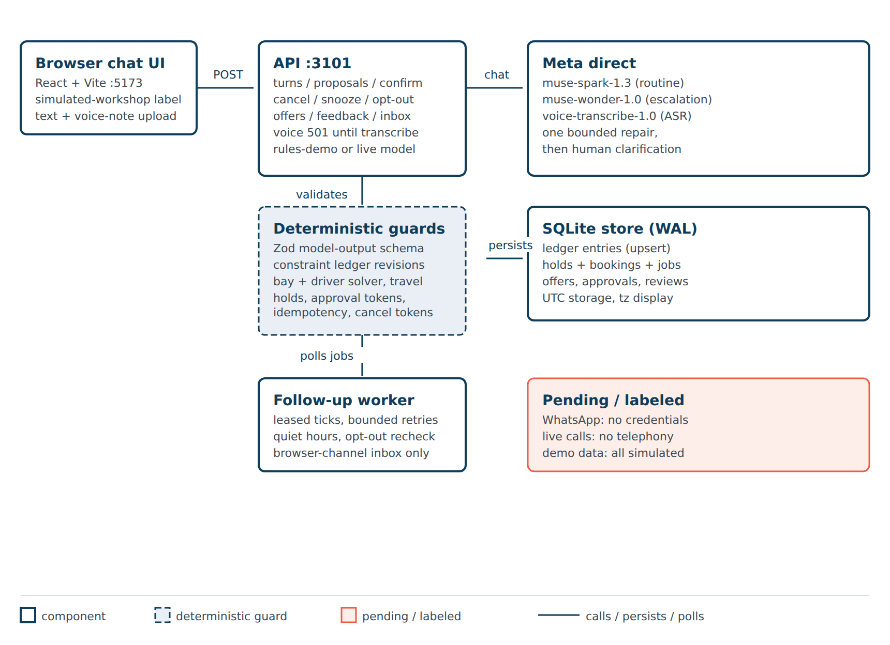
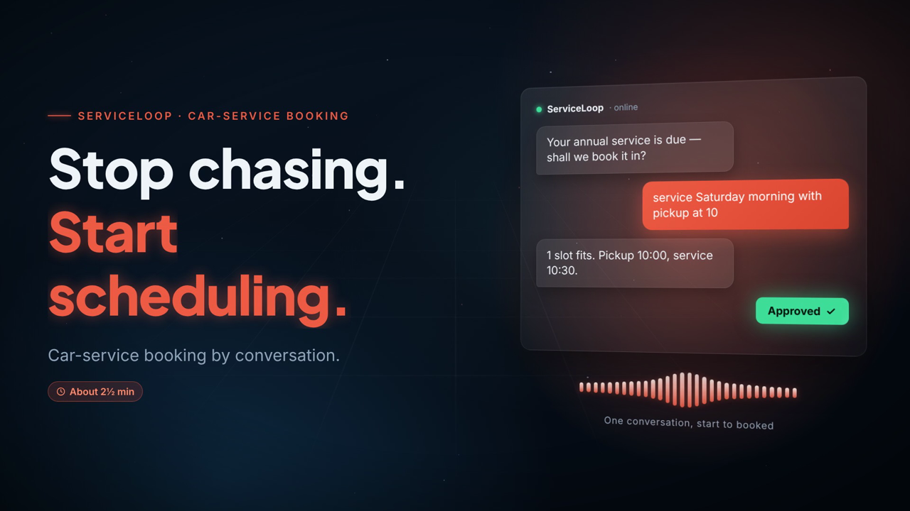

# ServiceLoop
**Stop chasing. Start scheduling.**

ServiceLoop turns vehicle-service reminders into customer-approved workshop appointments. Customers use browser chat (text plus voice-note upload) to change dates, require pickup, ask questions, snooze or stop outreach. Meta models interpret the conversation; deterministic code validates preferences, resource availability and approval before booking.

Status: working demo against a simulated workshop. No real appointments, no WhatsApp connection yet, no live calls.



[](evidence/demo-video/demo-booking.mp4)

## Run it

```bash
npm install
npm run build
npm test            # 55 tests: domain, api, concurrency, jobs, lifecycle, browser, live-model
node scripts/evaluate.mjs dev     # 20 dev scenarios, deterministic rules engine
node scripts/evaluate.mjs frozen  # 40 held-out multi-turn scenarios
```

Terminal 1 — API (stays in the foreground):

```bash
PORT=3101 DB_PATH=data/demo.db node dist/apps/api/src/start.js
```

Terminal 2 — web dev server:

```bash
npx vite --config apps/web/vite.config.ts apps/web --port 5173
```

Live demo: [serviceloop.yablokolabs.com](https://serviceloop.yablokolabs.com) — simulated workshop, live Meta interpretation, rate-limited (see `docs/HOSTING.md`). For local development, open `http://127.0.0.1:5173/` after the commands above. Every screen carries a simulated-workshop label.

Demo: `evidence/demo-video/demo-booking.mp4` (2:59, 1080p, narrated explainer: title, problem, 6-stage workflow, live booking in the real UI and API, win-back discount, feedback review, animated architecture, closing). Rendered by the Remotion pipeline in `apps/video` (frame-locked narration beats). The live segment was re-recorded on 2026-10-28 against the production site (serviceloop.yablokolabs.com) with the current UI, using deadline pacing in `scripts/record-scenes.mjs` so narration beats hold despite live-model latency; the earlier user-preferred localhost cut is superseded by this render. Narration is local Piper `en_GB-alba-medium`, loudness-normalized. Audio regression: `scripts/audit-video-audio.sh` fails if any 10 s window drops below -25 dB.

## How booking works

1. You type a message. Spark interprets it (Wonder on ambiguity, once), or the labeled `rules-demo` parser does.
2. The ledger stores your preferences as revisions. Nothing is overwritten.
3. The solver checks the bay plus pickup driver against your confirmed constraints.
4. You hold a slot, then approve with a token bound to that exact proposal and price.
5. Confirm is idempotent. Cancel needs the booking id plus a separate cancel token.
6. Snooze creates a persisted job. Opt-out cancels pending jobs and stops contact.

Offers are seeded workshop policy (`WELCOME10`, `STAFF20` needs staff approval, `EXPIRED5` expired). No endpoint creates offers. Changed terms invalidate the old approval; the new proposal needs fresh approval at the final price.

## Endpoints

| Method + path | Purpose |
|---|---|
| POST /api/turns | Interpret a message, update ledger, list slots or ask |
| POST /api/proposals | Hold a slot, optional offer code, returns approval token |
| POST /api/confirm | Approve with token plus idempotency key |
| POST /api/cancel | Cancel with booking id plus cancel token |
| POST /api/snooze | Schedule a persisted follow-up (browser channel only) |
| POST /api/optout | Stop reminders, cancel pending jobs |
| POST /api/offers/quote, /api/offers/approve | Deterministic offer evaluation, staff gating |
| POST /api/service-completed, /api/feedback | One feedback request, staff review on low ratings |
| GET /api/conversation/:id, /api/inbox | Ledger state, delivered follow-ups |

## Models

Meta-direct by default: `muse-spark-1.3`, `muse-wonder-1.0`, `muse-voice-transcribe-1.0`. Supply your own API key through the `META_API_KEY` environment variable; never commit keys. Optional Baseten mode is explicit opt-in with `BASETEN_API_KEY` and the exact model `meta-models/muse-spark-open-1026`. Provider details and measured comparisons: `docs/MODEL_CONFIGURATION.md`.

## Honest limits

- Workshop, bay, driver, prices and offers are seeded simulation.
- WhatsApp is not connected. No credentials configured, nothing sent.
- Voice-note upload in the browser returns an honest not-configured status until transcription is wired to the demo flow.
- Times display in Asia/Kolkata by default (configurable); storage is UTC.
- Evaluation: dev 20 and frozen 40 scenarios score precision/recall 1.0 on active constraints with zero bookings violating confirmed constraints. Original supplier smoke results stay untouched in `evidence/INITIAL_MODEL_SMOKE_TEST_RESULTS.md`.
- No license required by decision; no LICENSE file. No production or legal-compliance claim.
